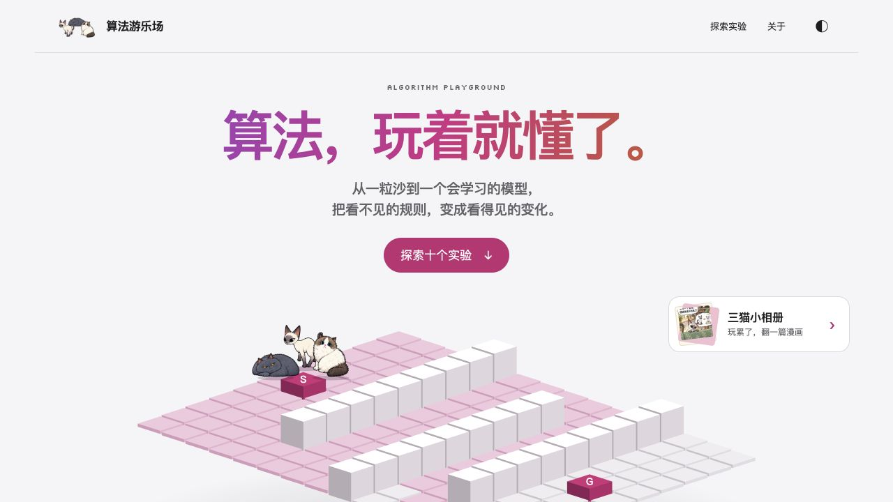

# Algorithm Playground — Learn with Three Cats

**Make a prediction. Change one thing. See why the result changed.**

[Play in your browser](https://haimuhaimu.github.io/algorithm-playground/) · [Start a learning route](https://haimuhaimu.github.io/algorithm-playground/learn.html#route-task) · [中文](README.md)

[](https://github.com/haimuhaimu/algorithm-playground/actions/workflows/pages.yml)

<a href="https://haimuhaimu.github.io/algorithm-playground/"></a>

Ten interactive algorithm labs, a distribution observatory, and three Agent missions. No account, API key, or paid model required. **The experiments currently use a Chinese-language interface**; this guide helps you find your way in.

I'm Chen Quan. When I learned classification, I started with points and decision boundaries before moving to formulas. This project turns that approach into small, playable experiments. The three cats appear as samples, passengers, clients and companions—not as an answer-giving tutor.

## Try one

| Start here | What you can investigate |
| --- | --- |
| [Pixel Post Office](https://haimuhaimu.github.io/algorithm-playground/pixel.html#first-letter) | Encode a cat postcard into real Huffman bytes, then decode it without losing pixels. |
| [Cat Classification](https://haimuhaimu.github.io/algorithm-playground/neural.html#cat-lesson) | Label samples and add a feature to separate two cats. The model reads demonstration feature values, not photographs. |
| [Pathfinding](https://haimuhaimu.github.io/algorithm-playground/pathfinding.html#cat-route-lab) | Change one obstacle and compare the cats' actual routes to the same snack. |
| [Distribution Observatory](https://haimuhaimu.github.io/algorithm-playground/distributions.html#observation-title) | Compare normal, exponential and Pareto samples against the same threshold. |
| [Agent Mission 1](https://haimuhaimu.github.io/algorithm-playground/agent-mission.html#mission) | Decide whether to check delivery, retry or stop when a tool reports “success.” |

The [full catalog](README.md#十个主实验) also covers recommendation, falling sand, coupled oscillators, genetic algorithms, exploration vs. exploitation, world models and rule revision. A [guided route](https://haimuhaimu.github.io/algorithm-playground/learn.html#route-task) connects classification, gradient updates and unseen test cases.

Agent missions continue with [rerouting and stale receipts](https://haimuhaimu.github.io/algorithm-playground/agent-reroute.html#mission), then [choosing three frames](https://haimuhaimu.github.io/algorithm-playground/agent-frames.html#mission). They use fixed scenes, not cameras, microphones or live models. You can explicitly take your action record to [GenAI Learning OS](https://haimuhaimu.github.io/genai-learning-os/) for review.

## Run locally

Node.js 24+. The browser has no third-party runtime dependencies. Local preview and builds use one pinned development dependency, `es-module-lexer`, to parse module references.

```sh
git clone https://github.com/haimuhaimu/algorithm-playground.git
cd algorithm-playground
npm ci --ignore-scripts
npm start
```

Open [http://127.0.0.1:3040/](http://127.0.0.1:3040/). Do not open source HTML directly with `file://`.

```sh
npm test         # Builds test artifacts, then runs Node's built-in test runner
npm run verify   # Syntax checks, all tests, and the static build
```

Source lives in feature directories under `src/`; artwork and fonts live in `assets/`. A single explicit allowlist maps those files to the existing flat public URLs. Preview and build rewrite module import paths for that public namespace; they do not bundle browser dependencies. See [Architecture](docs/ARCHITECTURE.md) for the directory map. `dist/` is generated: do not edit or commit it. GitHub Actions verifies pull requests and deploys the verified `main` branch to Pages.

## Help make it easier to learn

You do not need to write code. A confusing result or a button with no visible feedback is useful feedback.

- [Report a bug](https://github.com/haimuhaimu/algorithm-playground/issues/new?template=bug-report.yml).
- [Describe a learning roadblock](https://github.com/haimuhaimu/algorithm-playground/issues/new?template=learning-friction.yml).
- [Suggest a focused improvement](https://github.com/haimuhaimu/algorithm-playground/issues/new?template=improvement.yml).
- For code or documentation changes, read [CONTRIBUTING](CONTRIBUTING.md). English and Chinese issues/PRs are welcome; the templates have bilingual field labels.

Please omit private learning records, credentials and personal details from public reports. Prefer a small reproduction using the built-in examples.

## Tools for your own AI

An assistant with local execution access can discover supported tasks and replay exported records through the same teaching engines:

```sh
node scripts/learning-tool.mjs list
node scripts/learning-tool.mjs describe agent-frames
```

See [AI_USAGE](docs/AI_USAGE.md) and the [machine-readable manifest](src/integrations/learning-tool-manifest.json) for supported actions, limits and JSON examples. Only six fixed lessons currently have execution adapters; other games are browser-only. This is not a hosted API or a chatbot. A matching replay does not authenticate a person or prove that they mastered a concept.

## Scope and rights

These are simplified teaching models, not production AI benchmarks. Drafts and saved results stay in browser storage where supported; they are not cloud backups. Export and GenAI OS handoff are explicit user actions. Existing tests do not establish acceptance on every physical device. [EXPERIMENTS](EXPERIMENTS.md) documents the assumptions and implementation.

**This public repository does not currently carry an open-source license.** Code reuse or redistribution requires permission from the author; see [COPYRIGHT](COPYRIGHT). Three Cats Studio artwork and comics are not freely licensed for reuse. The bundled font retains its [SIL Open Font License](assets/fonts/Silkscreen-OFL.txt).

The preview above is a screenshot of the live homepage. © 2026 Chen Quan / 陈全.
