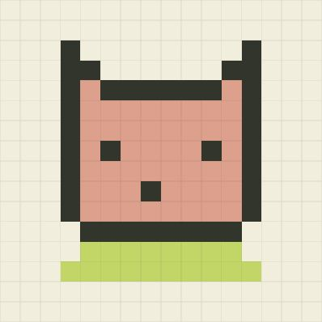

# 算法游乐场

**和三猫一起，把算法玩一遍。** 改一格路障，寄一封像素明信片，或给模型教一次分类。亲手做出一个改变，再看结果为什么不同。

[在线试玩 ↗](https://haimuhaimu.github.io/algorithm-playground/) · [从第一条学习路线开始 ↗](https://haimuhaimu.github.io/algorithm-playground/learn.html#route-task) · [AI 工具指南](AI_USAGE.md)

<a href="https://haimuhaimu.github.io/algorithm-playground/pixel.html#first-letter"></a>

我是陈全。我学分类时，先画点、看分界，再去理解公式。这里把这样的学习过程做成小游戏：先猜，亲手试一次，再拿结果或一道新题核对。三猫有时是样本，有时和你一起跑图、寄信、探矿。

## 第一次来，玩哪个？

- **想快速玩一局：** [寄一张三猫明信片](https://haimuhaimu.github.io/algorithm-playground/pixel.html#first-letter)，看看真实字节怎样还原成 256 格，再亲手读回 8 格。
- **想系统学一点：** [AI 怎么从例子里学会？](https://haimuhaimu.github.io/algorithm-playground/learn.html#route-task) 看分界、走一步梯度、拿新题检验；途中去自由涂鸦，再回来接着做。
- **想学 Agent：** [从一次可疑的「成功」开始](https://haimuhaimu.github.io/algorithm-playground/agent-mission.html#mission)。亲手作决定，再把实际操作带回 [GenAI Learning OS](https://haimuhaimu.github.io/genai-learning-os/) 复盘。

## 十个主实验

| 试玩入口 | 动手看什么 |
| --- | --- |
| [推荐系统](https://haimuhaimu.github.io/algorithm-playground/recommendation.html#seat-lesson) | 给首页排座；看同一张猫片为什么换一席就可能落选。 |
| [寻路竞技场](https://haimuhaimu.github.io/algorithm-playground/pathfinding.html#cat-route-lab) | 为三猫改一格路，比较路线；也能用 BFS 和 A* 单步找路。 |
| [落沙实验室](https://haimuhaimu.github.io/algorithm-playground/sand.html#grain-lab) | 看沙遇到水会怎样，再给臭臭的水碗开口，逐拍观察。 |
| [萤火虫合奏](https://haimuhaimu.github.io/algorithm-playground/firefly.html#firefly-pond) | 让波比拍一下，看看哪一片听见了，以及两群如何合拍。 |
| [遗传赛车](https://haimuhaimu.github.io/algorithm-playground/evolution.html#roadblock-lab) | 给旧冠军加路障，分开看同批车重排与继续繁衍的结果。 |
| [涂鸦训练场](https://haimuhaimu.github.io/algorithm-playground/neural.html#cat-lesson) | 用特征分辨波比和臭臭，再试分类分界、梯度、残差与新题。 |
| [盲盒探矿](https://haimuhaimu.github.io/algorithm-playground/mining.html#mining-flight) | 让三猫飞一趟，区分本次收获、累计样本和下一趟的选择。 |
| [像素邮局](https://haimuhaimu.github.io/algorithm-playground/pixel.html#first-letter) | 寄出真实 Huffman 字节包，看收件端逐位、无损地还原。 |
| [脑内预演室](https://haimuhaimu.github.io/algorithm-playground/world-model.html#flight-guide) | 让飞船先预测再实飞；分开看模型学到了什么、规划改变了什么。 |
| [AI 创作室](https://haimuhaimu.github.io/algorithm-playground/rsi.html#workshop) | 为波比修海报，拿新委托复测，再决定保留或撤回改法。 |

想继续探索：去 [贝叶斯小课](https://haimuhaimu.github.io/algorithm-playground/mining.html#bayes-start) 比较同一条新证据怎样改变两份记录的判断，或去 [分布观察台](https://haimuhaimu.github.io/algorithm-playground/distributions.html#observation-title) 用同一条红线比较正态、指数和帕累托样本。

## Agent 实战三关

1. [显示成功，补给真的到了吗？](https://haimuhaimu.github.io/algorithm-playground/agent-mission.html#mission) 查签收、重试或停止，区分工具回复和真实结果。
2. [新指令来了，旧任务还该继续吗？](https://haimuhaimu.github.io/algorithm-playground/agent-reroute.html#mission) 处理改派，判断迟到的旧回执还能证明什么。
3. [只留三帧，你会留下哪一帧？](https://haimuhaimu.github.io/algorithm-playground/agent-frames.html#mission) 用同一段画面、同样三帧预算，比较保留了哪些证据。

三关用固定场景模拟，不接摄像头、麦克风或付费模型。可主动将实操记录带回 GenAI Learning OS；完成实验不等于已掌握。

## 让自己的 AI 参与

有本地执行能力的 AI 可以用 [工具指南](AI_USAGE.md) 和 [能力清单](learning-tool-manifest.json) 发现工具、运行固定案例，或重算一份实际导出的实验记录。目前支持学习路线、像素解码、贝叶斯小课和 Agent 三关。其他实验仍需在浏览器里玩；清单不是在线执行服务，工具也不会读取你的画纸和草稿。

## 本地运行

需要 Node.js 24+，没有第三方运行依赖。

```sh
git clone https://github.com/haimuhaimu/algorithm-playground.git
cd algorithm-playground
npm start
```

打开 [http://127.0.0.1:3040/](http://127.0.0.1:3040/)。运行 `npm run verify` 会检查语法、跑测试并构建 `dist/`。[GitHub Actions](https://github.com/haimuhaimu/algorithm-playground/actions/workflows/pages.yml) 对 PR 执行相同验证；只从通过验证的 `main` 部署白名单产物。

## 边界与素材

互动在浏览器中运行，无需账号。画纸和草稿只保存在当前浏览器，学习路线往返使用同标签页的临时记录。操作记录不会自动上传或同步；要带去 GenAI Learning OS 复盘，由你主动发起。所有模型都是教学简化版；[实验与实现说明](EXPERIMENTS.md) 保留具体算法假设、源码入口和验收边界。

三猫角色与漫画来自三猫工作室；README 预览图是项目合成场景，不包含用户草稿。© 2026 陈全 / Chen Quan。代码和素材的复用规则见 [COPYRIGHT](COPYRIGHT)。
